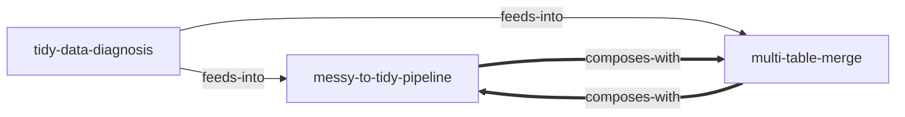

# Tidy Data — Skill Index

> 本书由 book2skill 蒸馏, 共产出 **3** 个 skills。
> 处理时间: 2026-05-15

## 关于这本书

- **作者**: Hadley Wickham
- **出版年**: 2014
- **一句话主旨**: 定义整洁数据的三条规则,用三种操作修复五种常见杂乱模式,使分析工具可自由组合
- **整书理解**: 见 [BOOK_OVERVIEW.md](./BOOK_OVERVIEW.md)

---

## Skill 列表 (按主题分组)

### 诊断与评估

- [`tidy-data-diagnosis`](./tidy-data-diagnosis/SKILL.md) — 识别数据集违反整洁规则的模式,输出结构化诊断报告

### 数据转换

- [`messy-to-tidy-pipeline`](./messy-to-tidy-pipeline/SKILL.md) — 从杂乱到整洁的端到端流程: melt → split → cast → 分表 → 验证

### 多表处理

- [`multi-table-merge`](./multi-table-merge/SKILL.md) — 多文件纵向合并 + 混合观察类型拆分,统一为"每种观察类型一张表"

---

## 引用图



图例:
- `-->` depends-on / feeds-into
- `===>` composes-with

**关系说明**:
- `tidy-data-diagnosis` → `messy-to-tidy-pipeline`: 诊断结果直接驱动修复操作序列
- `tidy-data-diagnosis` → `multi-table-merge`: 诊断识别模式 4/5 后推荐合并/拆分
- `messy-to-tidy-pipeline` ↔ `multi-table-merge`: 经常顺序配合 — 先合并多文件再 reshape,或先分表再分别整洁化

---

## 推荐学习顺序

(从依赖图的叶子节点开始, 向上)

1. **tidy-data-diagnosis** — 最基础, 没有前置; 先学会识别问题
2. **messy-to-tidy-pipeline** — 依赖诊断结果, 处理单表 reshape
3. **multi-table-merge** — 处理多表/多文件问题, 常与 pipeline 配合

---

## 接入 darwin-skill

所有 skill 均带有 `test-prompts.json` (darwin-skill 兼容格式), 可直接接入自动进化:

```
darwin evolve books/tidy-data/
```

---

## 审计轨迹

- 候选单元池: [candidates/](./candidates/)
- 被淘汰的候选 (含原因): [rejected/](./rejected/)
- BOOK_OVERVIEW: [BOOK_OVERVIEW.md](./BOOK_OVERVIEW.md)
