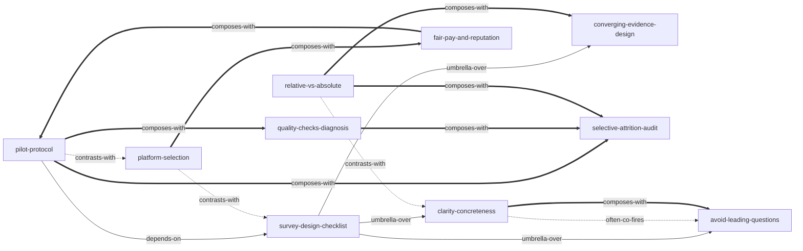

# Survey Curious? — Skill Index

> Distilled by book2skill. **10 atomic skills** extracted from Bergman, Chinco, Hartzmark, Sussman (2020).
> Distillation date: 2026-08-19.

## About this paper

- **Authors**: Abigail Bergman, Alex Chinco, Samuel M. Hartzmark, Abigail B. Sussman (Chicago Booth / NBER)
- **Year**: 2020
- **One-sentence thesis**: A credible online survey experiment requires three stacked layers — **question design** (asks respondents can and will answer honestly), **operational hygiene** (pilots, checks, attrition audits), **platform fit** (MTurk / CloudResearch / Prolific / Lucid matched to your target population).
- **Full reading**: see [BOOK_OVERVIEW.md](./BOOK_OVERVIEW.md)

---

## Skill list — by layer

### Layer 1 — Question design (run before writing or before launch)

- [`survey-design-checklist`](./survey-design-checklist/SKILL.md) — Umbrella skill. Run the three-constraint check (ability × willingness × interpretation) on every draft question.
- [`clarity-concreteness`](./clarity-concreteness/SKILL.md) — Anti-attribute-substitution: replace abstract nouns with named, dated, denominated references.
- [`avoid-leading-questions`](./avoid-leading-questions/SKILL.md) — Strip experimenter-demand framing; pick indirect elicitation for sensitive topics.
- [`converging-evidence-design`](./converging-evidence-design/SKILL.md) — Measure each construct with at least two items using different elicitation methods.

### Layer 2 — Operations & interpretation (run during/after field)

- [`pilot-protocol`](./pilot-protocol/SKILL.md) — Two-stage field test: pretest with non-economists, then pilot with 50-100 real respondents before full launch.
- [`quality-checks-diagnosis`](./quality-checks-diagnosis/SKILL.md) — Pick the right check (attention vs. comprehension vs. manipulation) given the failure mode.
- [`selective-attrition-audit`](./selective-attrition-audit/SKILL.md) — Audit completion-rate, check-pass-rate, response-time, demographics across conditions.
- [`relative-vs-absolute`](./relative-vs-absolute/SKILL.md) — Calibration of conclusions: levels are framing-fragile; comparisons are robust with order randomization.

### Layer 3 — Platform & people

- [`platform-selection`](./platform-selection/SKILL.md) — Match the platform to the target population, not to convenience.
- [`fair-pay-and-reputation`](./fair-pay-and-reputation/SKILL.md) — Pay platform norms; pay screened-out participants; monitor Turker-view reputation.

---

## Citation graph



**Legend**
- `-->` depends-on (A uses B as a prerequisite)
- `===>` composes-with (A and B are commonly used together)
- `-.->` contrasts-with (A and B share a category but are alternative choices)

---

## Recommended order of consultation

When you have **not** designed the survey yet:
1. `survey-design-checklist` — gate every draft question
2. `clarity-concreteness` — fix abstract nouns as they appear
3. `avoid-leading-questions` — strip demand-framing, replace sensitive-item methods
4. `converging-evidence-design` — add multi-item robustness

When you are **about to launch**:
1. `platform-selection` — pick the platform
2. `fair-pay-and-reputation` — set pay rate, design screening
3. `quality-checks-diagnosis` — choose checks given failure mode
4. `pilot-protocol` — run the two-stage field test

When you **have field data**:
1. `selective-attrition-audit` — verify internal validity
2. `relative-vs-absolute` — calibrate the conclusions you can draw

---

## Skill dependency graph (text version)

```
ROOT: survey-design-checklist
├── clarity-concreteness
├── avoid-leading-questions (often co-fires with clarity-concreteness)
└── converging-evidence-design (compose with relative-vs-absolute)

Layer-2 (operations):
  pilot-protocol depends-on survey-design-checklist
  pilot-protocol composes-with quality-checks-diagnosis
  pilot-protocol composes-with selective-attrition-audit

  relative-vs-absolute composes-with converging-evidence-design
  relative-vs-absolute composes-with selective-attrition-audit

Layer-3 (platform):
  platform-selection composes-with fair-pay-and-reputation
  platform-selection contrasts-with survey-design-checklist
  fair-pay-and-reputation composes-with pilot-protocol
```

---

## Connecting to darwin-skill

All 10 skills ship with `test-prompts.json` in darwin-compatible format. To run automatic evolution:

```
darwin evolve books/best-practices-running-surveys/
```

darwin will use the test cases in each skill to:
- Track trigger precision (does this skill fire when it should? does it stay silent when it shouldn't?)
- Detect coverage gaps (new trigger scenarios that emerged in real use but weren't in the original test set)
- Ratchet-tracked improvement of each skill's `description` and `E` (Execution) sections

---

## Audit trail

- Whole-book reading: [BOOK_OVERVIEW.md](./BOOK_OVERVIEW.md)
- Verified candidates (Stage 1.5 output): [verified.md](./verified.md)
- Raw candidates from 5 extractors: [candidates/](./candidates/)
  - `frameworks.md` — 10 candidates
  - `principles.md` — 12 candidates
  - `cases.md` — 7 candidates
  - `counter-examples.md` — 12 candidates
  - `glossary.md` — 15 glossary entries (not skills; shared across all)
- 10 SKILL.md files (one per skill folder)
- 10 test-prompts.json (one per skill folder)
